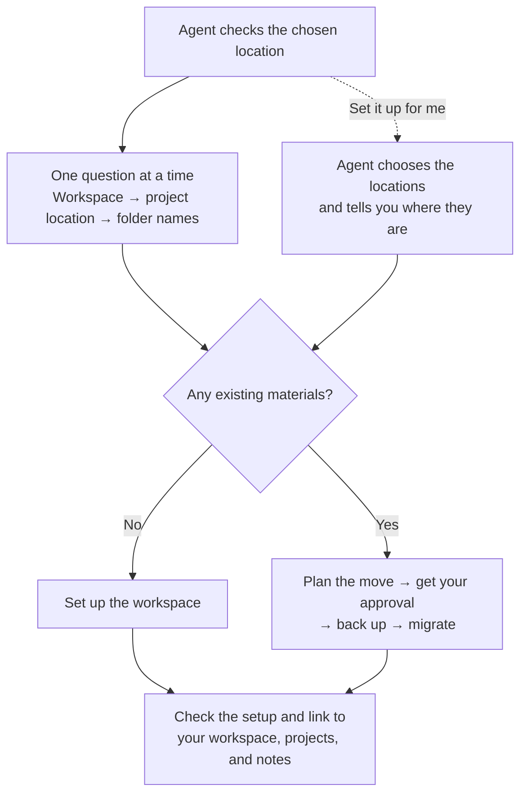

# Personal OS Starter

**English** · [Русский](README.ru.md)

**Your knowledge and project history, in files you can open with any agent.**

[Setup guide for agents (in Russian)](onboarding/README.md) · [What's inside](#whats-inside) · [Client guides (in Russian)](docs/CLIENTS.md)

Personal OS is a folder where you and your AI agent keep notes, preferences,
decisions, and work in progress. When you start a new chat, the agent can read
the relevant files and pick up where you left off.

> “Let's get back to the project. Where did we leave off, what have we checked,
> and what's the next step?” The answers live in your files.

## What you get

- **A map of your workspace.** You can see where your notes, projects, and instructions belong.
- **Continuity between chats.** The agent records decisions and the next step so you can return to them.
- **A setup that fits you.** As you work together, you define your preferences and the agent's role.
- **Freedom to switch clients.** You keep your files. A new agent can start from the same map.

The starter works with Codex, Claude Code, OpenCode, BB, and other clients with
file access. Each client has its own way to connect to the same workspace.
Choose a folder on Windows, macOS, or Linux.

## Principles

**Start small.** Begin with one useful task. Add folders, tools, and automation
as you need them.

**Read in context.** The agent starts with a map and a short set of rules. It
opens more detailed information about you, a project, or a tool when a task
calls for it. This approach is called progressive disclosure.

**Give each fact a home.** A project's status belongs with the project. Your
profile and preferences live in `personal/`. Instructions for a tool live with
the tool. Other documents link back to those sources.

**Keep it portable.** The workspace uses plain Markdown and relative links.
The agent checks the operating system, paths, and shell on your machine and
records them in your local `AGENTS.md`. The core has no required software dependencies.

**Keep it personal.** Everyone starts with a clean, private copy. Each workspace owner
keeps their own profile, memory, accounts, and permissions.

## What's inside

| Part of the starter | What it's for |
|---|---|
| [`workspace/`](workspace/README.md) | The files that become your Personal OS |
| [`onboarding/`](onboarding/README.md) | The guide your agent follows to set up the workspace and connect your client |
| [`docs/`](docs/ARCHITECTURE.md) | Architecture, clients, tools, and privacy |
| [`clients/`](docs/CLIENTS.md) | Optional client-specific instructions, currently available for BB |
| [`evals/`](evals/README.md) | Scenarios and results that maintainers use to check agent behavior |

## Your workspace

The starter uses English folder names. During setup, you can choose names you
already use, such as `Проекты/` and `Заметки/` for projects and notes.

```text
your chosen folder/
├── README.md       an introduction to your Personal OS
├── INDEX.md        the main map, organized by task
├── AGENTS.md       the agent's rules and local environment
├── LICENSE
├── .gitignore
├── personal/       your knowledge, profile, and preferences
│   └── INDEX.md    map of your personal materials
├── notes/          thoughts, ideas, and examples
├── projects/       your projects, tasks, decisions, and results
│   └── INDEX.md    project map
└── system/         instructions for running the workspace
    ├── INDEX.md    map of the system folders
    ├── agent/      the agent's identity, role, memory, and handoff notes
    ├── docs/       working rules and document templates
    ├── tools/      instructions for using tools
    ├── skills/     portable skills
    ├── infra/      devices and services
    ├── secrets/    rules for handling secrets (key values live elsewhere)
    └── temp/       temporary materials
```

Start with `README.md` for an overview, `INDEX.md` to find the right area, and
`AGENTS.md` for the working rules. Each area has its own index, and task files
hold the details. Add topics, projects, and tools as you need them.
[Architecture guide (in Russian)](docs/ARCHITECTURE.md)

## Getting started

Give this prompt to an agent with file access. The setup guide is in Russian,
and you can ask the agent to walk you through it in English.

```text
Set up Personal OS for me using the guide for agents:
https://github.com/ai-babai/personal-os-starter/blob/main/onboarding/README.md
Walk me through the folder choices in English. If I already have working files, show me the plan before moving them.
```

The agent gets the starter via Git or ZIP, checks your environment, and asks
only for choices you haven't made yet. Someone helping you set up can answer
the folder questions on your behalf. [Setup guide (in Russian)](onboarding/README.md)

On first use, the agent asks where to create the workspace, where projects
should live, and what to call your working folders. You can use existing folders.
If you ask it to choose for you, it picks the locations and tells you where
they are. If you already have materials to move, you approve the migration plan
first. [Migration guide (in Russian)](onboarding/MIGRATION.md)



Later, when you say “remember this,” the agent saves a thought in your notes
folder or a project decision where it applies. It gives you a link each time.

Connect email, Telegram, external skills, and other services when a task calls
for them. [Integrations (in Russian)](docs/INTEGRATIONS.md) · [Privacy (in Russian)](docs/PRIVACY.md)

---

[MIT License](LICENSE). External skills, clients, and services have their own terms.
