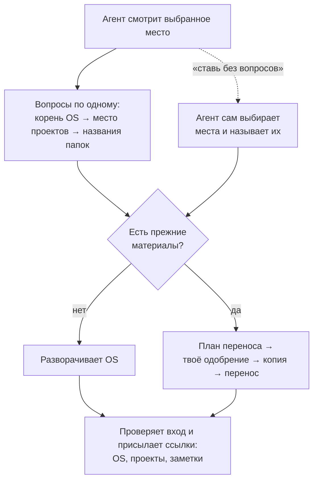

# Personal OS Starter

[English](README.md) · **Русский**

**Свои знания. Память между сессиями. Работа с любым агентом.**

[Онбординг для агента](onboarding/README.md) · [Что внутри](#что-внутри) · [Инструкции клиентов](docs/CLIENTS.md)

Personal OS — личная папка, в которой человек и ИИ-агент сохраняют знания,
предпочтения, решения и состояние проектов. Новый чат читает нужные документы
и получает точку продолжения предыдущей работы.

> «Продолжим проект. Найди, на чём мы остановились, что уже проверено
> и какой следующий шаг». Контекст для ответа хранится в твоих файлах.

## Что ты получишь

- **Понятную карту знаний.** У заметок, проектов и инструкций есть своё место.
- **Преемственность между чатами.** Агент сохраняет решения и следующий шаг.
- **Настройку под себя.** Профиль пользователя и рабочая роль агента формируются при знакомстве.
- **Возможность сменить клиент.** Файлы остаются у тебя; новый агент получает тот же вход.

Шаблон подходит для Codex, Claude Code, OpenCode, BB и других клиентов
с доступом к файлам. Способ подключения зависит от клиента; ядро общее.
Папка может находиться на Windows, macOS или Linux, в выбранном тобой месте.

## Принципы

**Минимализм.** Сначала одна полезная задача. Новые разделы, инструменты
и автоматизация появляются, когда они действительно нужны.

**Постепенное раскрытие — progressive disclosure.** На старте агент читает
карту и короткие правила. Подробности о владельце, проекте или инструменте
открывает по задаче, а не загружает всю базу в каждый чат.

**Один источник знания.** Состояние проекта живёт в проекте, профиль и предпочтения
пользователя — в `personal/`, процедура — рядом с инструментом. Остальные документы ссылаются на них.

**Переносимость.** Основа — обычный Markdown и относительные ссылки.
ОС, пути и оболочку агент определяет на месте и фиксирует в локальном `AGENTS.md`.
У ядра нет обязательных программных зависимостей.

**Личное остаётся личным.** Каждый человек получает чистую приватную копию.
Профиль, память, аккаунты и разрешения другого владельца не переносятся.

## Что внутри

| Часть комплекта | Назначение |
|---|---|
| [`workspace/`](workspace/README.md) | Готовые документы для твоей Personal OS |
| [`onboarding/`](onboarding/README.md) | Маршрут для агента: развёртывание и настройка входа |
| [`docs/`](docs/ARCHITECTURE.md) | Устройство, клиенты, инструменты и приватность |
| [`clients/`](docs/CLIENTS.md) | Необязательные инструкции конкретных клиентов; сейчас — BB |
| [`evals/`](evals/README.md) | Сценарии и результаты проверок поведения агентов для сопровождающих стартера |

## Структура личной OS

В шаблоне папки называются по-английски. При установке можно выбрать привычные названия, например `Проекты/` и `Заметки/`.

```text
выбранный корень/
├── README.md       описание личной OS
├── INDEX.md        главная карта: куда идти по задаче
├── AGENTS.md       правила агента и фактическая среда
├── LICENSE
├── .gitignore
├── personal/       знания, профиль и предпочтения пользователя
│   └── INDEX.md    карта личных материалов пользователя
├── notes/          свободные мысли, идеи и примеры
├── projects/       проекты пользователя: задачи, решения и результаты
│   └── INDEX.md    карта проектов
└── system/         служебные инструкции
    ├── INDEX.md    карта служебных областей
    ├── agent/      личность, роль и память агента; передача работы
    ├── docs/       рабочие правила и формы документов
    ├── tools/      инструкции инструментов
    ├── skills/     переносимые навыки
    ├── infra/      устройства и сервисы
    ├── secrets/    правила обращения с секретами, без значений ключей
    └── temp/       временные материалы
```

`README.md` объясняет назначение OS, `INDEX.md` ведёт к нужной области,
`AGENTS.md` задаёт правила работы. Индексы внутри разделов продолжают навигацию;
подробности остаются в документах задач. Конкретные темы, проекты и возможности
добавляются по мере необходимости. [Подробнее об устройстве](docs/ARCHITECTURE.md).

## С чего начать

При первом запуске агент спрашивает, где создать OS, где будут лежать проекты и как назвать рабочие папки.
Можно выбрать существующие папки. Если ты прямо попросишь ставить без вопросов,
агент выберет места сам и назовёт их. Если материалы уже есть, последним шагом
ты одобряешь [план миграции](onboarding/MIGRATION.md).

Потом на «запомни» агент кладёт свободные мысли в папку заметок, а правила и
решения по проекту — туда, где они работают. Каждый раз он присылает ссылку.



Передай агенту с доступом к файлам это поручение:

```text
Разверни для меня Personal OS по инструкции для агента:
https://github.com/ai-babai/personal-os-starter/blob/main/onboarding/README.md
Проведи меня через настройку папок. Если есть рабочие материалы, покажи план до переноса.
```

[Онбординг](onboarding/README.md) читает и выполняет агент: получает комплект
через Git или ZIP, определяет среду и задаёт только недостающие вопросы.
Настроить папки может и человек, который помогает владельцу с установкой.

Почта, Telegram, внешние навыки и другие подключения добавляются отдельно
по реальным задачам. [Инструменты](docs/INTEGRATIONS.md) · [Приватность](docs/PRIVACY.md).

---

[MIT License](LICENSE). У внешних навыков, клиентов и сервисов собственные условия.
