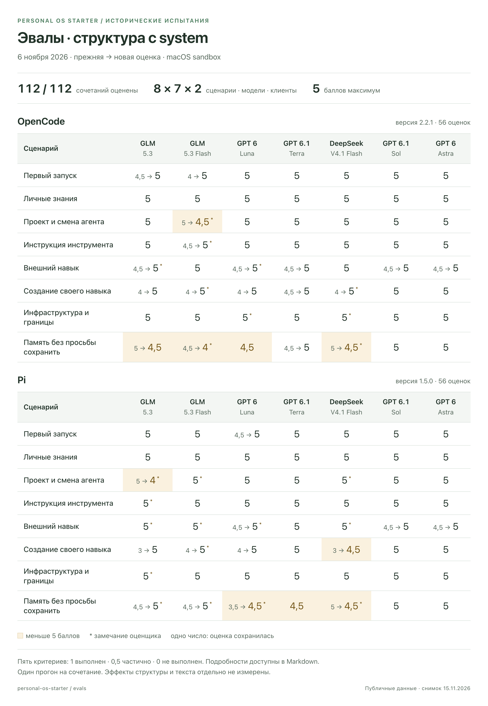
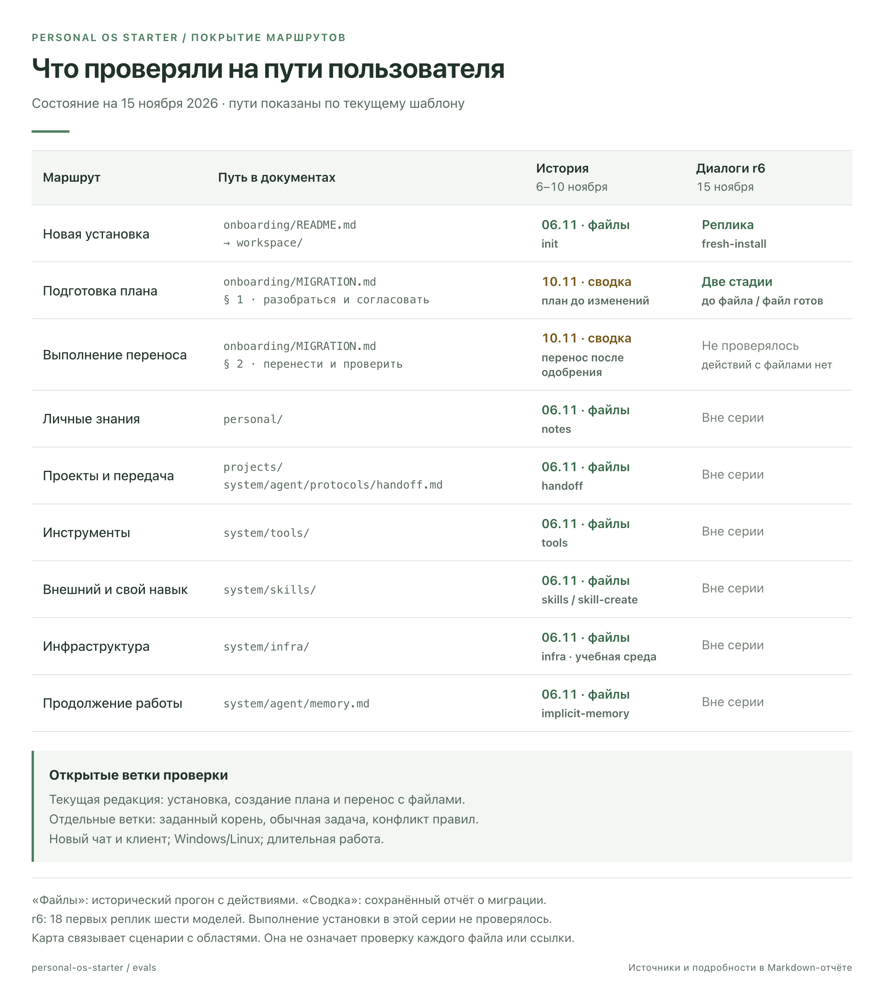

# Карта эвалов и покрытие путей

[Каталог evals](../README.md) · [Последние диалоги установки](../runs/2026-11-15-onboarding-r6/REPORT.md) · [История испытаний](2026-11-history.md)

Нажми изображение, чтобы открыть его в полном разрешении.
Точные оценки, критерии и замечания доступны в Markdown по ссылкам под картами.

## Исторические оценки

[Оценки и раскрываемые критерии](history/system-layout-2026-11-06.md) · [Исходная серия v0.3.1](history/baseline-2026-11-06.md)

Каждая историческая серия содержит 112 оценённых сочетаний и 560 оценок
критериев. Изображения сохраняют все итоговые баллы и отметки замечаний.
У каждого сочетания один прогон. Изменения текста и структуры отдельно
не измерялись; результаты относятся к историческим версиям стартера.

## Покрытие путей

Пути внутри личной OS показаны по текущему `workspace/`. Исторические
области сопоставлены с ними по назначению. Карта описывает охват сценариев;
она не подтверждает проверку каждого файла, ссылки или перехода между шагами.

Текстовая карта и ссылки на свидетельства

| Маршрут | Путь в текущем комплекте | Исторические свидетельства | Диалоги r6 |
|---|---|---|---|
| Новая установка | [onboarding/README.md](../../onboarding/README.md) → [workspace/](../../workspace/INDEX.md) | [Действия с файлами, 6 ноября](history/system-layout-2026-11-06.md#scenario-init) | [Первая реплика](../cases/fresh-install/input.md) |
| Подготовка плана | [MIGRATION.md, фаза 1](../../onboarding/MIGRATION.md#1-разобраться-и-согласовать) | [Сводка миграции, 10 ноября](2026-11-history.md#миграция-10-ноября) | [Файл ещё не готов](../cases/existing-folder/input.md); [файл уже готов](../cases/migration-plan-ready/input.md) |
| Выполнение переноса | [MIGRATION.md, фаза 2](../../onboarding/MIGRATION.md#2-перенести-и-проверить) | [Сводка переноса после одобрения, 10 ноября](2026-11-history.md#миграция-10-ноября) | Действия с файлами не проверялись |
| Личные знания | [personal/](../../workspace/personal/INDEX.md) | [notes](history/system-layout-2026-11-06.md#scenario-notes) | Вне серии |
| Проекты и передача | [projects/](../../workspace/projects/INDEX.md), [handoff.md](../../workspace/system/agent/protocols/handoff.md) | [handoff](history/system-layout-2026-11-06.md#scenario-handoff) | Вне серии |
| Инструменты | [system/tools/](../../workspace/system/tools/INDEX.md) | [tools](history/system-layout-2026-11-06.md#scenario-tools) | Вне серии |
| Внешний и свой навык | [system/skills/](../../workspace/system/skills/INDEX.md) | [skills](history/system-layout-2026-11-06.md#scenario-skills), [skill-create](history/system-layout-2026-11-06.md#scenario-skill-create) | Вне серии |
| Инфраструктура | [system/infra/](../../workspace/system/infra/INDEX.md) | [infra, учебная среда](history/system-layout-2026-11-06.md#scenario-infra) | Вне серии |
| Продолжение работы | [system/agent/memory.md](../../workspace/system/agent/memory.md) | [implicit-memory](history/system-layout-2026-11-06.md#scenario-implicit-memory) | Вне серии |

Для диалогов приведены входы сценариев. Все 18 ответов и их оценки находятся
в [отчёте r6](../runs/2026-11-15-onboarding-r6/REPORT.md#оценка-по-критериям).

**Виды свидетельств:** 6 ноября выполнялись действия в синтетических файловых
пространствах macOS; опубликованы обезличенные оценки и последние сообщения.
Для миграции 10 ноября доступна сводка, исходные трассы сюда не перенесены.
15 ноября r6 проверял 18 первых реплик шести моделей. Создание готового плана
было условием сценария, действия с файлами не выполнялись.

**Открытые ветки:** установка, создание плана и перенос текущей редакции
с проверкой файлов; отдельные случаи уже заданного корня, обычной задачи
в готовой OS и конфликта правил; подключение нового чата и клиента;
Windows/Linux и длительная работа.

## Об изображениях

PNG сняты с локальных HTML-макетов в двойном разрешении: 2240 пикселей по ширине.
Числа взяты из встроенных данных опубликованных исторических HTML;
карта путей составлена по связанным выше отчётам и текущим инструкциям.
Изображения доступны прямо в GitHub, Markdown сохраняет текстовые детали.
Новых прогонов моделей при оформлении не было.
