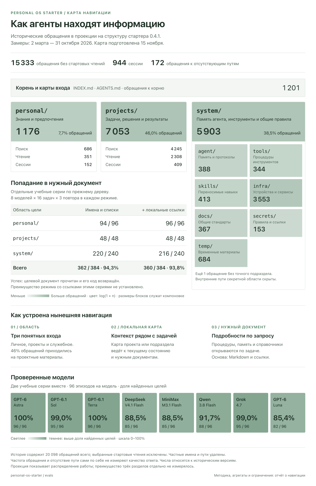

# Как агенты находят информацию

[Открыть картинку крупнее](assets/navigation-2026-11-15.png) · [Обезличенные агрегаты](assets/navigation-2026-11-15.json) · [Каталог evals](../README.md)

Карта адаптирует исследование от 31 октября к структуре стартера **0.4.1**.
Исторические обращения сгруппированы по назначению нынешних областей.
Новых измерений после реорганизации здесь нет.

## Что эти данные говорят о структуре

- **Проекты требуют хороших локальных карт.** На них приходилось 46% извлечённых
  обращений без выбранных стартовых чтений. Такая плотность работы делает
  карты проектов и точки продолжения приоритетом для проверки и улучшений.
- **Служебным материалам нужен понятный вход.** Области, теперь собранные
  в `system/`, дали 38,5% обращений. В учебных задачах их находили реже, чем
  личные и проектные материалы. Это основание разбирать конкретные маршруты,
  названия и переходы внутри служебных областей.
- **Само добавление ссылок не показало общего улучшения.** В двух учебных
  сериях получено 362 и 360 успешных эпизодов из 384. Малую разницу нельзя
  интерпретировать как надёжный эффект структуры или свойство модели.

Три раздела в корне выражают выбор по смыслу: личные знания, проекты,
работа агента и общая инфраструктура. Далее открываются локальная карта
и документ задачи. Это проектное решение в пользу минимализма и постепенного
раскрытия. Его преимущество над прежним корнем отдельно не измерялось.
Устройство и переносимость описаны в [архитектуре](../../docs/ARCHITECTURE.md).

История обращений: точные числа и единицы

Источник охватывает одно рабочее пространство за **2 марта — 31 октября 2026**:
20 098 извлечённых обращений из 1 169 сессий Codex/BB и OpenCode.
После исключения 4 765 выбранных стартовых чтений остаются **15 333 обращения
из 944 сессий**. Стартовая категория определялась по корневым картам,
bootstrap, identity, памяти и предпочтениям; это приближение.

| Область в нынешней структуре | Обращения | Доля | Сессии | Обращения к отсутствующим путям |
|---|---:|---:|---:|---:|
| Корень и карты входа | 1 201 | 7,8% | 360 | 3 |
| `personal/` | 1 176 | 7,7% | 152 | 12 |
| `projects/` | 7 053 | 46,0% | 409 | 108 |
| `system/` | 5 903 | 38,5% | 605 | 49 |
| Вся выборка | 15 333 | 100% | 944 | 172 |

Единица обращения: уникальное сочетание инструментального вызова, операции
и нормализованного пути. Родитель включает обращения к своим подразделам.
Сессии пересекаются между областями, поэтому их счётчики не складываются.
На картинке цвет соответствует `log(1 + n)`; площадь блока служит компоновке.

«Отсутствующий путь» подтверждался явной диагностикой инструмента с совпавшим
путём. Это число событий, включая повторные обращения. Оно не является числом
уникальных сломанных путей или частотой семантической ошибки агента.

Распознаны явные файловые операции: чтение, поиск, список, смена папки
и метаданные. Произвольные программы, косвенные пути и скрытые загрузки клиента
могли не попасть в выборку. Неизвестные результаты не приравнивались к успеху.
Старые пути сопоставлялись по документированным переходам; их существование
сегодня не использовалось как проверка результата исторического обращения.

Как старые области приведены к нынешней структуре

`personal/` и `projects/` остались самостоятельными входами. Прежние служебные
области сгруппированы в `system/`. Счётчики отражают назначение материалов;
они не утверждают, что все исторические файлы существуют по новым адресам.

| Нынешняя область | Обращения | Правило проекции |
|---|---:|---|
| `system/agent/` | 388 | Прежняя агентская область, за исключением вынесенных процедур и навыков |
| `system/tools/` | 344 | Процедуры инструментов и два обращения к вынесенной агентской процедуре |
| `system/skills/` | 413 | Прежние `tools/skills` и `tools/adapters` |
| `system/infra/` | 3 553 | Прежняя инфраструктурная область |
| `system/docs/` | 367 | Общие стандарты и документы |
| `system/secrets/` | 153 | Прежняя секретная область, без раскрытия внутренних путей |
| `system/temp/` | 684 | Временные материалы по назначению |
| Без точного подраздела | 1 | Обращение к общей прежней папке навыков агента |

Современный `system/secrets/` хранит правила и ссылки на внешнее хранилище.
Содержимое исторической секретной области по этим счётчикам не определяется.
Временные материалы учитываются как категория, фактический перенос каждого
из них не подразумевается. Проекции давней активной работы в нынешний архив
также не доказывают, что архив полезен как сегодняшняя точка входа.

Учебная навигация: попадание в цель и условия

В каждом режиме 8 моделей × 16 задач × 3 повторных запроса = **384 эпизода**.
Всего 768. Успех означает, что агент прочитал целевой документ и вернул его
точный встроенный код. Это более узкая проверка, чем решение реальной задачи.

| Область цели, сгруппированная по нынешнему назначению | Имена и списки | Добавлены локальные ссылки |
|---|---:|---:|
| `personal/` | 94 / 96 | 96 / 96 |
| `projects/` | 48 / 48 | 48 / 48 |
| `system/` | 220 / 240 | 216 / 240 |
| Всего | 362 / 384 (94,3%) | 360 / 384 (93,8%) |

| Историческая модель | Имена и списки | Добавлены локальные ссылки | Всего | Найдена цель |
|---|---:|---:|---:|---:|
| GPT-6 Astra | 48 / 48 | 48 / 48 | 96 / 96 | 100% |
| GPT-6.1 Sol | 48 / 48 | 47 / 48 | 95 / 96 | 99,0% |
| GPT-6.1 Terra | 48 / 48 | 48 / 48 | 96 / 96 | 100% |
| DeepSeek V4.1 Flash 1017 | 44 / 48 | 41 / 48 | 85 / 96 | 88,5% |
| MiniMax M3.1 Flash | 41 / 48 | 44 / 48 | 85 / 96 | 88,5% |
| Qwen3.8 Flash | 44 / 48 | 44 / 48 | 88 / 96 | 91,7% |
| Grok 4.7 | 48 / 48 | 47 / 48 | 95 / 96 | 99,0% |
| GPT-6 Luna | 41 / 48 | 41 / 48 | 82 / 96 | 85,4% |

Плитки на картинке суммируют обе серии: 48 + 48 эпизодов на модель.
Процент равен числу успешных эпизодов, делённому на 96; округление до десятых.
Заливка линейно темнеет по шкале 0–100%. Это описательная сводка попадания
в целевой документ в этих условиях. Порядок моделей сохранён из исследования.

Модели работали по виртуальному протоколу со списком файлов, чтением
учебных документов и поиском по именам. Корневой список был доступен сразу;
чтение INDEX выбирала сама модель. Допускалось до четырёх раундов,
по два действия на задачу за раунд. Все 16 задач передавались одним пакетом;
результаты внутри пакета коррелируют.

Проверялось прежнее дерево с восемью областями. Нынешний корень из трёх разделов
в этих сериях не участвовал. Наборы задач областей различались по составу
и сложности. В учебных телах отсутствовало частное содержимое. Поиск по содержимому,
RAG, полнота индексов, реальные файловые действия и весь набор задач OS
этими сериями не проверялись.

Ссылочный режим добавлен после разбора первой серии. В нём были те же 16 целей
и папки, реальные локальные переходы и один дополнительный отвлекающий файл.
Сравнение не было заранее спланированным строгим A/B; причинный эффект
и статистическая значимость не установлены.

Astra, Sol и Terra использовали изолированный native Codex CLI с reasoning low;
остальные модели использовали OpenRouter с доступными им параметрами.
Клиенты и настройки различались. Точные исторические ID сохранены в JSON.
Технический пилот с подсказкой от оценщика и ранняя невалидная попытка исключены
из знаменателей обеих серий.

## Происхождение и приватность

Для этой публикации повторно посчитаны обезличенные агрегаты сохранённого
исследования от 31 октября. Исходные события сверены с его `history.json`;
учебные итоги сверены с двумя сохранёнными `benchmark.json`.
SHA-256 источников и правила проекции включены в
[агрегированный набор](assets/navigation-2026-11-15.json).

Опубликованы только счётчики основных областей и учебных результатов.
Частные названия проектов, подпапки, исходные запросы, пути машин,
идентификаторы сессий, сырые журналы и сведения о личных бюджетах исключены.
Полное независимое воспроизведение исходных измерений требует закрытых данных;
публичный набор позволяет проверить сводные числа и построить картинку.

Новых запросов к моделям при подготовке этой карты не было. Для оценки нынешней
структуры нужен отдельный сопоставимый прогон на одинаковых задачах с фиксацией
маршрута, успеха и затрат поиска.
